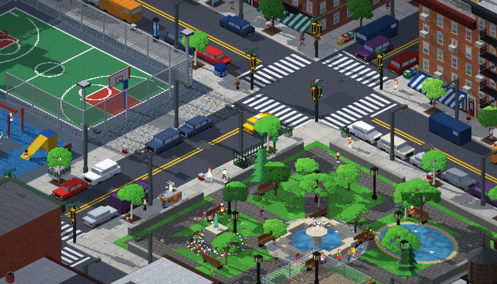

# PIXEL NYC

A living, isometric pixel-art New York City diorama that runs in the browser. Everything you see
and hear is generated procedurally at load time: no image or sound files.



## Run it

Just open `index.html` in a browser — it loads the pre-built bundle `dist/pixel-nyc.js`, so it
works straight from disk, from any static server, or on GitHub Pages. Requires WebGL2 (any recent
Chrome, Edge, Firefox or Safari).

For development, `dev.html` loads the ES modules in `src/` directly (serve the folder, e.g.
`python3 -m http.server 8000`, then open `http://localhost:8000/dev.html`). After changing the
sources, rebuild the bundle with:

```bash
npm install
npm run build
```

## What's in the city

- **4×4 blocks** of Manhattan/Brooklyn-style city on a floating diorama slab, with a big
  **central park** filling the middle four blocks and twelve city blocks around it. The slab's
  cross-section reveals soil, schist and utility pipes — and a **subway tunnel** where silver
  trains loop around the city and stop at a tiled station with passengers waiting on the platform.
  - an art-deco skyscraper with stepped setbacks and a crown that lights up at night in seasonal
    colours, a blue glass curtain-wall tower, a dark bronze modernist tower with plaza fountains,
    a limestone office with a copper roof, and a hotel with a vertical neon sign and marquee
  - rows of **brownstones** with stoops, iron railings, cornices, areaway gardens and backyards
  - red-brick **walk-ups** with zig-zag fire escapes, storefronts (bodega, pizza, laundromat,
    coffee, bar, florist…), awnings, roll-down graffiti gates at night, ghost signs on side walls
  - cast-iron **lofts** with a sidewalk shed, a firehouse, a movie theater marquee
  - rooftops packed with water towers (some painted like flags), billboards, bulkheads, HVAC,
    chimneys, satellite dishes, roof decks and gardens
- A **basketball court** with chain-link fence, hoops and floodlights, a playground with swings,
  slide and sprinkler, and a handball wall with a mural.
- The **park** (across the road from the court) takes over the streets between its four blocks:
  a stone wall with gate pillars, a loop drive for joggers, an elm-lined promenade leading to a
  tiered fountain on a paved terrace, a mown oval Great Lawn, a lake with an island, rocky
  shores, a boat dock and rowboats (an ice rink in winter), a statue garden with formal flower
  beds, a cherry grove, a wooded ramble with pines and boulders, a dog run, and over a hundred
  trees, lanterns and benches. Benches line its outer wall, and the bus loops round it.
- Streets with crosswalks, working **traffic and pedestrian signals**, street lamps, hydrants,
  mailboxes, newspaper boxes, bus shelters, subway entrances with green globes, food carts, and
  orange-and-white **steam stacks** and manholes that billow steam.

## Life

- **People** with routines: commuters heading for the subway, office workers, lunch at the halal
  cart, kids after school, joggers, dog walkers, tourists, retirees feeding pigeons, stoop sitters
  on summer evenings, trick-or-treaters in autumn. They path-find along sidewalks, wait for the
  WALK signal, climb stoops, enter shops and come out with bags, and open umbrellas in the rain.
- **Traffic**: yellow cabs, cars, vans, trucks and buses obey signals, turn, yield to pedestrians
  and oncoming traffic, park and pull out. A bus loops round the park between stops; a fire truck sometimes races
  out with sirens; garbage trucks run in the morning; an ice-cream truck plays its jingle in summer;
  snow plows clear winter streets. Late at night signals switch to flashing yellow/red.
- **Animals**: pigeon flocks peck, scatter when people pass, perch on lamps and water towers and
  wheel over the rooftops; dogs on leashes stop to sniff; squirrels, ducks, bodega cats, rats at
  night and migrating geese in autumn.

## Time, seasons and weather

- A full **day/night cycle** with a moving sun and real-time shadows, moonlight, stars, lit windows
  that switch on through the evening, street lamps with light pools, neon, headlights and bloom.
- **The season changes every day**: spring (cherry blossoms, tulips, showers) → summer (pickup
  basketball, open fire hydrant, sprinklers, fireflies, fireworks) → autumn (orange foliage,
  falling leaves, pumpkins, geese) → winter (snow, snowball fights, snowmen, skating, Christmas
  tree and lights, heavier steam).
- **Weather**: clear, cloudy, rain (wet reflective streets and puddles), thunderstorms with
  lightning, snow and fog. Cloud shadows drift across the city.

## Sound

All sound effects are synthesised live with WebAudio and positioned by where they happen on
screen: city hum, wind, rain and thunder, birdsong, crickets, car horns, sirens, bus air brakes,
the ice-cream truck, ball dribbles/rim/swish, snowballs, pigeon coos and wing flaps, barking dogs,
geese, subway rumble, crosswalk chirps and fireworks. Click **♪** to turn sound on.

## Controls

| Input | Action |
| --- | --- |
| Drag | Pan |
| Wheel / pinch / `+` `-` | Zoom (pixel-perfect steps) |
| `Q` / `E` | Rotate the view 90° |
| Click a person | Follow them (see their name and what they're thinking) |
| `WASD` / arrows | Pan |
| `Space` | Pause / resume time |
| `T` | Time speed (1×, 3×, 10×, 30×) |
| `1`–`4` / `0` | Pick a season / back to daily seasons |
| `F` / `Esc` | Follow a random person / stop following |
| `X` | Fireworks |
| `M` | Sound on/off |
| `H` | Help |

URL parameters are handy for jumping straight to a moment, e.g.
`?hour=21&season=3&weather=snow&zoom=3&rot=1`.

## How it works

- `src/render/` – a WebGL2 renderer with a true 2:1 pixel projection rendered into a low-res buffer
  and scaled up with nearest-neighbour filtering. The art is authored at 32 texels per world unit
  (one unit is 2 m, so 16 pixels per metre); the default zoom shows one art pixel per CSS pixel. Passes: sun shadow map → world-space light map
  (lamps, shop windows, headlights, fireworks) → scene (MRT colour + glow + depth) → bloom →
  composite with sub-pixel smooth scrolling and depth-based outlines.
- `src/world/` – the procedural city: a pixel painter writes facades, roofs and the ground into a
  texture-array atlas (the alpha channel encodes when each window lights up), and a mesh builder
  creates boxes, prisms, cylinders and alpha-tested quads (railings, fences, fire escapes).
- `src/render/sprites.js` – palette-indexed sprites: one person template covers every skin, hair
  and clothing colour (26×42-pixel figures with faces, hairstyles, hats, coats, bags and a shaded
  outline); trees swap palettes per season (leaves hide in winter, revealing branches).
- `src/render/carLayer.js` – instanced 3D vehicles. Bodies are lofted from cross-sections
  (chamfered corners, sloped hoods and windshields, cabins that narrow towards the roof) with
  10-sided wheels, hubcaps, bumpers, mirrors and light bars. Their textures are projected from the
  palette atlas, so headlights, brake lights, sirens and lit bus windows switch via palette rows.
- `src/sim/` – environment (clock, sun, seasons, weather), traffic, pedestrians and navigation,
  activities, animals and particles.
- `src/audio/` – the procedural sound engine.
