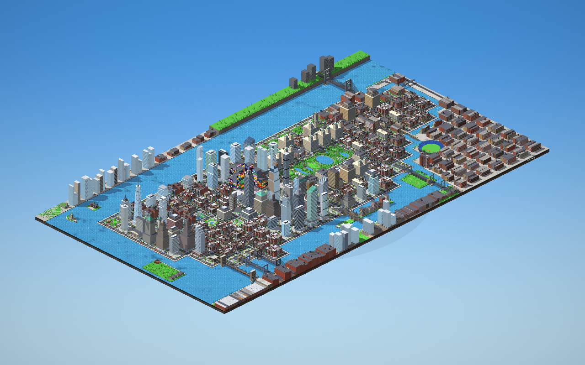

# PIXEL NYC

A living, isometric pixel-art New York City diorama that runs in the browser. Everything you see
and hear is generated procedurally at load time: no image or sound files.


## Run it

Just open `index.html` in a browser — it loads the pre-built bundle `dist/pixel-nyc.js`, so it
works straight from disk, from any static server, or on GitHub Pages. Requires WebGL2 (any recent
Chrome, Edge, Firefox or Safari).

For development, `dev.html` loads the ES modules in `src/` directly (serve the folder, e.g.
`python3 -m http.server 8000`, then open `http://localhost:8000/dev.html`). After changing the
sources, rebuild the bundle with:

```bash
npm install
npm run build
```

## What's in the city



- **The whole of Manhattan, Inwood to the Battery**, on a floating diorama slab: 30 rows of blocks
  (each standing for four to ten real streets, closer together in Midtown and downtown) up to ten
  avenues wide, about 240 blocks of island, following the real shoreline — narrow in the north,
  bulging through Midtown, the Lower East Side sticking out into the East River, tapering to the
  Battery. Riverside drives ring it. Across the
  rivers lie the **edges of greater New York**: the **Palisades** cliffs, Fort Lee, Hoboken and
  Jersey City's towers in **New Jersey**; Riverdale and blocks of apartment houses round **Yankee
  Stadium** (limestone arches, the white frieze, the scoreboard) in **the Bronx**; Astoria, **Long
  Island City**'s glass towers and Gantry Plaza with the **Pepsi-Cola sign** in **Queens**;
  **Brooklyn**'s waterfront with whole streets of brownstones, walk-ups and DUMBO's lofts behind it
  and the **Domino Sugar** sign in Williamsburg. Their blocks are built with the same generators as
  Manhattan's (stoops, fire escapes, shopfronts, water towers), not as plain boxes. And the islands — **Randall's**,
  **Roosevelt** (apartment towers, lighthouse, Four Freedoms Park), **Governors** (Castle Williams,
  Fort Jay), **Ellis** and **Liberty**.
- **Bridges leading out**: the **George Washington Bridge** (two decks, steel lattice towers, four
  cables, the little red lighthouse underneath), the **Henry Hudson Bridge**'s arch over Spuyten
  Duyvil, **High Bridge**'s stone arcade and steel arch, the **Triborough** (lift span, viaduct over
  Randall's Island, suspension span to Queens), the **Hell Gate Bridge**'s crimson steel arch between
  granite towers, the **Queensboro Bridge**'s cantilever truss over
  Roosevelt Island with the **tram** beside it, the **Williamsburg**, **Manhattan** (with its arch
  and colonnade) and **Brooklyn Bridges**. Strings of lights hang along their cables at night. Each
  one is joined up at both ends: its ramp starts down on the avenue in Manhattan, and on the far
  side it comes down off the deck onto a road that runs on into Queens, Brooklyn or the Bronx
  (the Henry Hudson Bridge lands on Riverdale's ridge).
- Pick a place from the **GO TO** menu to glide there (the camera turns to that place's best
  side), or press **V** for a bird's-eye view. Zoom right out to see the whole island. The slab's
  cross-section reveals soil, schist and utility pipes — and a **subway tunnel** where silver trains
  loop around the city and stop at a tiled station with passengers waiting on the platform.
  - uptown: **Inwood Hill Park**'s forest, Fort Tryon Park and **the Cloisters**, Highbridge Park's
    water tower, **Columbia**'s Low Library, the **Apollo** on 125th Street, **Riverside Park** all
    down the Hudson with **Grant's Tomb**, **Riverside Church** and the **Soldiers' and Sailors'
    Monument**
  - uptown: **St John the Divine**, **Gracie Mansion** in Carl Schurz Park on the East River, and
    **the Dakota**'s green roofs, gables and corner pavilions on Central Park West
  - on the Hudson: the **Intrepid** on its pier (aircraft carrier with planes on the deck and its
    island, the submarine alongside, the shuttle pavilion), the **High Line**'s planted viaduct
    running three blocks through Chelsea over the cross streets (people walk it, up the stairs at
    each end), and **Little Island** on its field of concrete tulips
  - Midtown: **Radio City Music Hall** with its neon marquee round the corner and the tall sign,
    **Macy's** on Herald Square with its display windows, red awnings and star sign
  - downtown: **Union Square** with its greenmarket, **City Hall** and the **Woolworth Building**,
    **Trinity Church**'s brownstone spire and graveyard at the head of Wall Street, **Bowling
    Green**'s oval inside its iron fence with the **Charging Bull** and the Custom House, **South
    Street Seaport** with Pier 17 and two tall ships, and the **Staten Island Ferry** terminal with
    orange ferries in the slips and out in the bay
  - pre-war apartment towers along the park: twin-towered with little temples on top on Central
    Park West, limestone under slate mansards on Fifth Avenue, buff brick with art deco setbacks
  - **no two ordinary towers alike**: each is generated from its block and its district. Heights
    follow the real skyline (peaks in Midtown and the Financial District, lower through Chelsea and
    the Village); the era sets the look — glass curtain walls in eight tints and four mullion
    patterns, mid-century slabs on plazas with pools, art deco wedding cakes with crowns lit at
    night, pre-war limestone and brick office blocks with water towers. Footprints, podiums, twin
    towers, setbacks, chamfered corners and crowns (penthouse, mast, spire, pyramid, slanted top,
    glass lantern) vary, and every lobby has its own street address
  - **real towers in their real blocks**: the Seagram Building and Lever House on Park Avenue,
    Citigroup Center on its four columns with its slanted top, the Hearst Tower's diagrid, the New
    York Times Building's ceramic rods, One Vanderbilt and the MetLife Building over Grand Central,
    40 Wall Street's green pyramid, 70 Pine Street's lantern, 8 Spruce Street's rippling steel and
    56 Leonard Street's stacked boxes, plus the Billionaires' Row supertalls (111 West 57th, 432
    Park); pencil-thin supertalls, a hotel with a vertical neon sign and marquee
  - rows of **brownstones** with stoops, iron railings and areaway gardens, red-brick **walk-ups**
    with zig-zag fire escapes and storefronts (bodega, pizza, laundromat, coffee, bar, florist…),
    cast-iron **lofts** in SoHo, a firehouse, a movie theater marquee
  - rooftops packed with water towers (some painted like flags), billboards, bulkheads, HVAC,
    chimneys, satellite dishes, roof decks and gardens
  - **shopping streets**: a storefront in every building (shoes, fashion, electronics, toys,
    jewellery, bakery, records, sports…) with window displays, awnings, sandwich boards and
    district banners on the lamp posts, and a limestone **department store**
- **Landmarks**, each built from the same pixel kit as the rest of the town (and each on the
  GO TO menu):
  - round Central Park: the **Guggenheim**'s white spiral, **the Met**'s Beaux-Arts front with its
    banners, steps and fountains, the **Natural History** museum with its glass-cube planetarium,
    **Lincoln Center**'s fountain between the opera's arches, **Columbus Circle**'s twin towers and
    column, and **the Plaza** with its green copper roofs, the Pulitzer fountain and a gilded general
  - **St Patrick's Cathedral**: white marble, twin spires, a rose window and stained glass
  - the **United Nations**' green glass slab by the East River, its row of flags on First Avenue
  - **Hudson Yards**' glass towers with the observation deck, and the copper honeycomb Vessel
  - the **9/11 Memorial**: two square pools, water falling into the voids, bronze parapets, a grove
    of oaks, and the Oculus's white ribs
  - **Battery Park** at the southern tip: lawns, plane trees, Castle Clinton's round fort, the glass
    carousel
  - an **Empire State**-style art-deco tower with five setbacks, full-height aluminium piers, a
    crown lit in seasonal colours and the mooring mast on top — the tallest thing in Midtown
  - a **Chrysler**-style tower: white brick, steel eagles at the setback, a crown of stacked
    stainless sunbursts with triangular windows, and the needle spire
  - **One World Trade Center**, its square glass shaft twisting into eight triangular facets as
    it rises to a parapet and a long spire
  - **Rockefeller Center**: the limestone slab over the sunken plaza (fountains in summer, a rink
    in winter) with the golden statue, a ring of flags, and the big tree at Christmas
  - the **Flatiron** wedge on its triangular lot, prow pointing up the avenue, beside a plaza with
    tables and a sidewalk clock
  - **Grand Central**'s Beaux-Arts front (three great arched windows, the clock and sculpture on
    top) with the office slab rising behind it
  - the **Public Library**, a marble palace behind wide steps and two stone lions, with **Bryant
    Park**'s lawn, gravel walks, plane trees, benches and fountain behind it
  - an **arena**: a great drum of concrete fins on a glass podium wrapped in marquee screens
  - the **Stock Exchange**'s temple front — six giant columns, a sculpted pediment and a huge flag
  - **Washington Square**: lawns, paths, the round fountain and the white marble arch
  - **Chinatown**: red-and-gold shopfronts (dumplings, tea, herbs, seafood, bakeries), red
    lanterns strung along the street and a gate with a green-tiled roof
  - the **Brooklyn Bridge**, river to river: an arched stone approach climbing from Manhattan to the
    granite anchorage, then over FDR Drive and the East River through two Gothic towers standing in
    the water to the Brooklyn anchorage. Four main cables sag across the main span, hung with
    suspenders and the web of diagonal stays; roadways run either side of the raised wooden
    promenade, which people walk across (stairs down to Brooklyn's promenade at the far end)
  - **Brooklyn's waterfront** across the river: a promenade with benches facing the skyline, lawns,
    the carousel in its glass box, brick warehouses and brownstones, a subway station
  - the **Statue of Liberty** on her island in the harbour: copper-green, torch held high, the
    crown's seven rays, the tablet, the stola draped over the folds of her gown, the broken chain at
    her feet; the granite pedestal with its loggias and balcony on Fort Wood's eleven-pointed star;
    lawns, trees, a museum pavilion and a ferry at the pier; floodlit at night
- **Times Square** takes over four blocks in Midtown (one block south of the park): the streets inside are closed to traffic and paved into one pedestrian plaza, ringed by
  towers whose facades are stacked with animated screens, lit billboards and a scrolling news
  ticker. Its south-east corner is left open as a square of its own, where red bleacher steps rise
  behind a ticket booth, crowded with people taking in the lights, among café tables, planters,
  carts and floodlights. A bronze statue stands at the north end and a tower with a crystal ball on
  its mast at the south end (the ball drops at midnight on winter nights, then fireworks). All the ads are made up; at night the screens wash the square in colour.
- **Central Park**, six blocks long and two wide (59th to 110th Street), takes over the streets inside it and is laid out like the real
  one from north to south: **Harlem Meer**, the North Woods with the Loch and the Great Hill, the
  **Conservatory Garden** (fountain, beds, hedges, a wisteria pergola) and a dog run; the
  **Reservoir** inside its fence and running track, a gatehouse and cherry trees on its bank; the
  **Great Lawn** with its ballfields, **Turtle Pond** under **Belvedere Castle** on Vista Rock, and
  **Cleopatra's Needle**; the wooded **Ramble** down to **the Lake**, crossed by cast-iron **Bow
  Bridge**, with the **Boathouse** and its rowboats; **Bethesda Terrace** and its fountain with the
  angel, the **Mall**'s double row of elms, **Sheep Meadow**, **Strawberry Fields** and its "Imagine"
  mosaic; **Wollman Rink** and **the Pond** with stone **Gapstow Bridge** at the bottom. The drive loops
  round it all, stone walls run round the edge with a gate at every street, and thousands of trees,
  lanterns and benches fill the rest. The bus loops round it, and the walking paths, bridges and
  sights (Bethesda Terrace, the Reservoir, the castle, Bow Bridge, Harlem Meer, the Great Lawn) are
  on the GO TO menu. The city opens over the park.
- A **basketball court** with chain-link fence, hoops and floodlights, a playground and a handball
  wall with a mural, in the Village by Washington Square — where the real West 4th Street courts are.
- Streets with crosswalks, working **traffic and pedestrian signals**, street lamps, hydrants,
  mailboxes, newspaper boxes, bus shelters, subway entrances with green globes, food carts, and
  steel **vent grates in the sidewalks** and manholes that puff steam (most in winter).

## Life

- **People** with routines: commuters heading for the subway, office workers, lunch at the halal
  cart, kids after school, joggers, dog walkers, tourists, retirees feeding pigeons, stoop sitters
  on summer evenings, trick-or-treaters in autumn. They path-find along sidewalks, wait for the
  WALK signal, climb stoops, enter shops and come out with bags, and open umbrellas in the rain.
  They are **little 3D figures**, each posed every frame (swinging arms and legs as they walk,
  pumping them as they run, sitting on benches and stoops, waving, aiming, lying where they fall)
  and dressed from their own outfit: hair (short, long, ponytail, bun, afro, spiky), hats (cap,
  fedora, beanie, police cap, hood, helmet, witch's hat), short or long sleeves, jackets, long
  coats and puffers, trousers, shorts, skirts and dresses, scarves, glasses, ties, backpacks,
  shoulder bags, briefcases, shopping bags and canes, in their own colours.
- **Trees in 3D**: plane trees, locusts, oaks, elms, cherries and pines, each a trunk with branches
  reaching into a crown of faceted leaf clusters (or stacked cones), speckled light and dark like
  pixel foliage. Leaves turn in autumn and fall in winter to show the bare branches, with snow on
  them after a snowfall; every tree casts a real shadow.
- **Traffic**: yellow cabs, cars, vans, trucks and buses obey signals, turn, yield to pedestrians
  and oncoming traffic, park and pull out. A bus loops round the park between stops; a fire truck sometimes races
  out with sirens; garbage trucks run in the morning; an ice-cream truck plays its jingle in summer;
  snow plows clear winter streets. Late at night signals switch to flashing yellow/red.
- **Animals**: pigeon flocks peck, scatter when people pass, perch on lamps and water towers and
  wheel over the rooftops; dogs on leashes stop to sniff; squirrels, ducks, bodega cats, rats at
  night and migrating geese in autumn.

## Time, seasons and weather

- A full **day/night cycle** with a moving sun and real-time shadows, moonlight, stars, lit windows
  that switch on through the evening, street lamps with light pools, neon, headlights and bloom.
- **The season changes every day**: spring (cherry blossoms, tulips, showers) → summer (pickup
  basketball, open fire hydrant, sprinklers, fireflies, fireworks) → autumn (orange foliage,
  falling leaves, pumpkins, geese) → winter (snow, snowball fights, snowmen, skating, Christmas
  tree and lights, heavier steam).
- **Weather**: clear, cloudy, rain (wet reflective streets and puddles), thunderstorms with
  lightning, snow and fog. Cloud shadows drift across the city.

## Sound

All sound effects are synthesised live with WebAudio and positioned by where they happen on
screen: city hum, wind, rain and thunder, birdsong, crickets, car horns, sirens, bus air brakes,
the ice-cream truck, ball dribbles/rim/swish, snowballs, pigeon coos and wing flaps, barking dogs,
geese, subway rumble, crosswalk chirps and fireworks. Click **♪** to turn sound on.

## Play mode

Press **P** (or **PLAY** in the toolbar) to take over whoever you are following, or the person
nearest the middle of the screen; the camera switches to the bird's-eye view and follows you.

- Walk with **WASD** / arrows (relative to the screen), **Shift** to run. Buildings, walls,
  fences and cars are solid.
- **F** next to a car gets you in: a parked car (it may set off its alarm) or a moving one — the
  driver gets out and runs off shouting. **F** again gets you out; the car stays where you left it.
- Drive with **W/S** to accelerate and brake/reverse, **A/D** to steer, **Space** for the
  handbrake (the tail slides out). Cars are rigid bodies with momentum and spin: hits push, spin
  and stop cars instead of passing through them, lane traffic gets knocked off its lane in a real
  crash (or nudged back onto it after a bump), and parked cars get shoved.
- **Damage** collects on the side that took the hit: the front or back crumples, the sides dent
  where they were struck, panels get scraped to bare metal, lamps smash and glass cracks. A badly
  hurt engine smokes (grey, then black), then catches fire; a burning car explodes a few seconds
  later — a fireball, debris in the car's own paint, a scorch mark, a jolt of the camera — throwing
  nearby cars about (chain reactions included) and knocking people flat. What's left is a burnt-out
  shell that smoulders for a while.
- **The pistol**: aim with the mouse and **click** to shoot (hold to keep firing), or **Space** on
  foot to shoot at whoever is in front of you; **R** reloads the 12-round clip. It works out of a
  car window too. People who are shot go down in a spreading pool of blood; police officers take
  two hits. Each shot leaves a muzzle flash and a glowing tracer that streaks to whatever it hits.
  Gunfire sends everyone nearby running and the pigeons into the air; shooting a car dents it,
  breaks its glass and eventually sets it on fire.
- **Knock things over**: drive into a street lamp or a traffic-signal pole fast enough and it
  goes down — it topples the way you were going, bounces and lies across the sidewalk or the
  street, its lamp dark or its signals dead (a slow bump just stops you). The city puts fallen
  poles back up later, out of sight.
- **Wanted level**: the moment the police come after you, you get **one star** out of five. The
  longer the chase runs and the more damage you do (cars wrecked, people hurt, officers down),
  the more stars — and the more police cars, faster and pushier: from three stars they cut you
  off, from four they ram. Crimes the police don't see still get reported by witnesses a few
  seconds later. Cars pull up and officers jump out to chase you on foot, guns drawn; if they
  grab you (or their cars box you in) you're **BUSTED** and released across town with a clean
  slate. Break line of sight and keep out of view (a low wall or a bench won't hide you); when the
  stars start blinking they're searching, and if they don't find you, you've lost them. Hide
  somewhere a car can't reach — inside the park walls, out on a plaza — and the patrol car parks as
  close as it can get while its crew comes in after you on foot.
- **Esc** (or **P**) hands the person back to their day.

## Controls

| Input | Action |
| --- | --- |
| Drag | Pan |
| Wheel / pinch / `+` `-` | Zoom (pixel-perfect steps) |
| `Q` / `E` | Rotate the view 90° |
| Click a person | Follow them (see their name and what they're thinking) |
| `WASD` / arrows | Pan |
| GO TO menu | Glide to the park, Times Square, the landmarks, the bridge, the statue… |
| `V` | Bird's-eye / isometric view |
| `P` | Play as someone (see Play mode) |
| Click / `Space` / `R` (playing) | Shoot / shoot on foot or handbrake in a car / reload |
| `Space` | Pause / resume time |
| `T` | Time speed (1×, 3×, 10×, 30×) |
| `1`–`4` / `0` | Pick a season / back to daily seasons |
| `F` / `Esc` | Follow a random person / stop following |
| `X` | Fireworks |
| `M` | Sound on/off |
| `H` | Help |

URL parameters are handy for jumping straight to a moment, e.g.
`?hour=21&season=3&weather=snow&zoom=3&rot=1`.

## How it works

- `src/render/` – a WebGL2 renderer with a true 2:1 pixel projection rendered into a low-res buffer
  and scaled up with nearest-neighbour filtering. The art is authored at 32 texels per world unit
  (one unit is 2 m, so 16 pixels per metre); the default zoom shows one art pixel per CSS pixel. Passes: sun shadow map → world-space light map
  (lamps, shop windows, headlights, fireworks) → scene (MRT colour + glow + depth) → bloom →
  composite with sub-pixel smooth scrolling and depth-based outlines.
- `src/world/` – the procedural city: a pixel painter writes facades, roofs and the ground into a
  texture-array atlas (the alpha channel encodes when each window lights up), and a mesh builder
  creates boxes, prisms, cylinders and alpha-tested quads (railings, fences, fire escapes).
  `layout.js` is the 15×36 block map of Manhattan (merged regions for Central Park and Times
  Square; the roads follow the land), with the other boroughs and the islands as regions. `ground.js`
  rasterises it into a land map (water, road, sidewalk, other boroughs) that drives the ground
  geometry, the quays and the collision grid; the ground texture is stored as tiles over the land
  only, looked up through an index texture in the shader, so the water costs nothing.
  `centralpark.js` builds the park, `manhattan.js` and `uptown.js` the towers, museums and plazas,
  `skyline.js` the tower generator and the real towers, `landmarks.js` the older skyscrapers, the
  Brooklyn Bridge and the statue, `bridges.js` the other bridges,
  `greater.js` the boroughs and islands, `sights.js` the newer sights (Intrepid, High Line, Radio
  City, Macy's, Trinity, Bowling Green, the ferry, the Seaport, the Dakota, Gracie Mansion, the
  Domino sign), `timessq.js` the square. To keep the big map
  quick to build and light on memory, ordinary blocks come in a few seeded variants per type whose
  atlas art is painted once and reused, and the ground is painted at half the art resolution with
  the fine grain added back in the shader.
- `src/render/sprites.js` – palette-indexed sprites (animals, props, effects) and the seasonal
  palettes. `src/render/personLayer.js` draws the people as instanced, jointed 3D figures (one mesh
  holds every hairstyle and garment, each instance its pose and a mask of what it wears);
  `src/render/treeLayer.js` the 3D trees. `src/sim/poles.js` knocks lamps and signal poles over.
- `src/render/carLayer.js` – instanced 3D vehicles. Bodies are lofted from cross-sections
  (chamfered corners, sloped hoods and windshields, cabins that narrow towards the roof) with
  10-sided wheels, hubcaps, bumpers, mirrors and light bars. Their textures are projected from the
  palette atlas, so headlights, brake lights, sirens and lit bus windows switch via palette rows.
  Crash damage is per instance: the vertex shader crumples the ends and dents the sides around
  the point of impact, the fragment shader scrapes paint, smashes lamps, crazes glass and chars
  burnt-out shells.
- `src/render/decalLayer.js` – flat marks on the ground (blood pools that spread, splatter, scorch
  marks) as instanced quads lying on the ground plane, lit like everything else.
- `src/sim/` – environment (clock, sun, seasons, weather), traffic, pedestrians and navigation,
  activities, animals and particles. The simulation keeps its detail around where you're looking
  (or who you're playing): people and cars appear nearby and quietly retire far off-screen, so the
  whole city stays alive without simulating every street at once. `vehicles.js` is the car physics (boxes with momentum and
  spin, tyre grip, wall contacts from the collision grid, separating-axis contacts with impulses
  between cars, damage, fire and explosions) and `player.js` the play mode (driving, the pistol,
  the wanted level, police in cars and on foot).
- `src/audio/` – the procedural sound engine.
